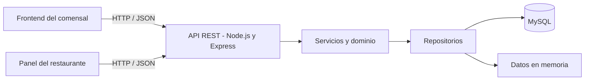

# DEVORA

**Comparte la mesa, no la confusión.**

Sistema de gestión de pedidos individuales para mesas grupales de restaurantes.

Proyecto de Ingeniería de Software — Universidad Privada Boliviana (UPB).

## 1. Descripción

DEVORA permite que los comensales de una mesa consulten el menú, registren pedidos y visualicen su consumo individual. El restaurante puede consultar los pedidos registrados, identificar a los comensales y filtrar los pedidos por mesa.

Este repositorio contiene el primer incremento funcional del proyecto. Su alcance comprende el flujo de pedidos individuales y su persistencia; los pagos reales y el cierre de mesas quedan pendientes.

## 2. Funcionalidades del primer incremento

- Identificación de mesas mediante un enlace y registro de comensales.
- Consulta del menú de productos y selección de cantidades.
- Registro de pedidos individuales y adición de productos a pedidos existentes.
- Cálculo del total desde el backend y visualización del consumo individual.
- Consulta de pedidos y filtrado por mesa en el panel del restaurante.
- Validación de solicitudes y soporte de idempotencia en la API para prevenir duplicados cuando se reutiliza una clave de idempotencia.
- Almacenamiento de pedidos y sus detalles mediante MySQL.
- Modo de demostración del comensal con datos y pagos simulados, separado del modo conectado a la API.

## 3. Tecnologías utilizadas

- HTML5, CSS3 y JavaScript (ECMAScript Modules).
- Node.js y Express.
- MySQL.
- API REST con intercambio de información en JSON.
- Git y GitHub.
- Node.js Test Runner.

## 4. Arquitectura

DEVORA utiliza una arquitectura cliente-servidor. Las dos interfaces web se comunican con el backend mediante HTTP y JSON; ninguna accede directamente a MySQL.



El backend selecciona una fuente de datos mediante `DATA_SOURCE`: `memory` o `mysql`. El repositorio simulado del frontend es independiente de estas dos opciones y se utiliza únicamente con el parámetro `demo=1`.

### Backend

| Componente | Responsabilidad |
|---|---|
| Rutas | Definir los endpoints HTTP por recurso. |
| Controladores | Recibir solicitudes y devolver respuestas. |
| Servicios | Aplicar reglas de negocio y coordinar operaciones. |
| Dominio | Validar datos, representar errores y calcular montos. |
| Repositorios | Acceder a datos en memoria o MySQL mediante un contrato común. |

### Frontend modular del comensal

El frontend fue refactorizado con una organización basada en MVC (Modelo-Vista-Controlador), separando responsabilidades entre controladores, modelos, vistas e infraestructura.

| Componente | Responsabilidad |
|---|---|
| `codigo/configuracion/` | Configuración de rutas, dirección de la API y modo de ejecución. |
| `codigo/dominio/` | Contratos, modelos, validaciones y estrategias de pago. |
| `codigo/infraestructura/` | Cliente HTTP, repositorios, fábricas, almacenamiento de sesión y datos simulados. |
| `codigo/presentacion/` | Controladores de sesión, menú, eventos, pedidos y pagos. |
| `interfaz/` | Vistas, estilos y recursos gráficos. |
| `codigo/inicio.js` | Punto de entrada de la aplicación. |
| `js/` | Adaptadores de compatibilidad con módulos anteriores. |

Patrones de diseño incorporados:

- **Factory:** selección del repositorio HTTP o simulado y creación de estrategias de pago.
- **Repository:** contrato común para el acceso a los datos, independiente de su origen.
- **Strategy:** separación de las variantes de pago por efectivo y QR.

Los controladores especializados comparten el estado de la aplicación mediante una fachada principal. La capa de aplicación independiente queda pendiente de implementación explícita. Los pagos simulados no representan transacciones financieras reales.

### Panel modular del restaurante

El panel utiliza módulos ECMAScript (`import` y `export`) para separar sus responsabilidades.

| Módulo | Responsabilidad |
|---|---|
| `config.js` | Configuración de la dirección base de la API (`/api`). |
| `api.js` | Solicitudes HTTP y validación de respuestas. |
| `view.js` | Manipulación del DOM y presentación de información. |
| `app.js` | Coordinación de módulos, eventos e inicialización. |

Se aplica inyección de dependencias para sustituir la comunicación HTTP y el documento HTML durante las pruebas, sin depender de un servidor o una base de datos real.

## 5. Estructura del repositorio

Se muestran los archivos y directorios principales (estructura abreviada).

```text
DEVORA/
├── backend/
│   ├── docs/
│   ├── src/
│   │   ├── config/
│   │   ├── controllers/
│   │   ├── domain/
│   │   ├── middlewares/
│   │   ├── repositories/
│   │   ├── routes/
│   │   └── services/
│   ├── tests/
│   ├── .env.example
│   ├── API.md
│   ├── package-lock.json
│   └── package.json
├── frontend-comensal/
│   ├── comensal/
│   │   ├── codigo/
│   │   │   ├── configuracion/
│   │   │   ├── dominio/
│   │   │   ├── infraestructura/
│   │   │   ├── presentacion/
│   │   │   └── inicio.js
│   │   ├── interfaz/
│   │   │   ├── estilos/
│   │   │   ├── recursos/
│   │   │   └── vistas/
│   │   ├── js/
│   │   └── index.html
│   ├── test/
│   ├── ARQUITECTURA.md
│   └── package.json
├── panel-restaurante/
│   ├── js/
│   │   ├── api.js
│   │   ├── app.js
│   │   ├── config.js
│   │   └── view.js
│   ├── test/
│   │   └── panel.test.mjs
│   ├── index.html
│   ├── styles.css
│   └── package.json
└── README.md
```

## 6. Requisitos de instalación

- Git.
- Node.js 22 (versión utilizada en el entorno de pruebas) y npm.
- Navegador web moderno.
- MySQL Server 8 para almacenamiento persistente (probado con MySQL 8.4.13).

MySQL no es obligatorio para ejecutar el backend en modo memoria. Los dos frontends utilizan JavaScript nativo y no requieren instalar dependencias adicionales para servir sus interfaces.

## 7. Instalación y ejecución

Los siguientes comandos están preparados para PowerShell en Windows.

Clonar el repositorio y registrar la revisión descargada:

```powershell
git clone https://github.com/jeremybecerra/DEVORA.git
cd DEVORA
git rev-parse HEAD
```

Para reproducir específicamente la revisión evaluada en la sección 11, ejecutar `git switch --detach 0a20c1c` una vez disponible dicho commit en el repositorio descargado. Para trabajar sobre la versión de entrega, conservar la rama correspondiente.

Instalar las dependencias del backend a partir del archivo de bloqueo:

```powershell
cd backend
npm.cmd ci
```

Crear la configuración local, sin sobrescribir un archivo existente:

```powershell
if (-not (Test-Path .env)) {
    Copy-Item .env.example .env
}
```

Revisar que `DATA_SOURCE=memory` para iniciar sin MySQL. Comprobar también que las rutas de las interfaces correspondan a las indicadas en la sección 8.

Iniciar el servidor:

```powershell
npm.cmd start
```

Los pedidos del modo memoria se pierden al reiniciar el backend. Para conservarlos, configurar MySQL según la siguiente sección. Mantener el servidor en ejecución mientras se utilizan las interfaces.

## 8. Configuración de MySQL

### Instalación inicial

1. Instalar MySQL Server 8 e iniciar su servicio.
2. Conectarse como administrador desde la carpeta `backend/`.
3. Ejecutar el esquema SQL en una instalación local nueva.

```powershell
mysql --default-character-set=utf8mb4 -u root -p
```

Si `mysql` no está disponible en el PATH de Windows, utilizar la ruta completa de `mysql.exe`. Dentro del cliente MySQL, ejecutar:

```sql
SOURCE docs/esquema-mysql.sql;
```

El script crea la base de datos `devora`, cinco tablas, ocho mesas y nueve productos iniciales. No volver a ejecutar el esquema sobre datos existentes sin revisar sus efectos y contar con un respaldo adecuado.

Crear un usuario exclusivo para el backend, si todavía no existe:

```sql
CREATE USER 'devora_app'@'127.0.0.1'
IDENTIFIED BY RANDOM PASSWORD;

GRANT SELECT, INSERT, UPDATE, DELETE
ON devora.*
TO 'devora_app'@'127.0.0.1';
```

Guardar de forma privada la contraseña generada. Si el usuario ya existe, revisar sus permisos y utilizar su contraseña local en lugar de crearlo nuevamente.

### Configuración del backend

Editar el archivo `backend/.env`:

```dotenv
DATA_SOURCE=mysql
DB_HOST=127.0.0.1
DB_PORT=3306
DB_USER=devora_app
DB_PASSWORD=
DB_NAME=devora
FRONTEND_DIR=../frontend-comensal/comensal
PANEL_DIR=../panel-restaurante
```

Completar `DB_PASSWORD` con la contraseña local. Conservar las demás variables requeridas por `.env.example`. No publicar el archivo `.env` ni incluir credenciales en capturas o reportes.

Reiniciar el backend (`Ctrl + C` y `npm.cmd start`, desde `backend/`). En otra terminal, comprobar la conexión:

```powershell
Invoke-RestMethod http://localhost:3000/api/salud
```

La respuesta debe indicar `estado: ok`, `baseDatos: ok` y `fuenteDatos: mysql`.

## 9. Acceso al sistema

| Componente | Dirección local |
|---|---|
| Comensal (conectado a la API) | <http://localhost:3000/?mesa=05> |
| Restaurante | <http://localhost:3000/panel/> |
| API REST | <http://localhost:3000/api> |
| Estado del sistema | <http://localhost:3000/api/salud> |
| Comensal en modo demostración | <http://localhost:3000/?mesa=05&demo=1> |

Abrir las interfaces a través del servidor HTTP, no directamente como archivos HTML locales. Para verificar la integración y persistencia, utilizar el modo conectado a la API, sin `demo=1`. Una ventana privada del navegador permite comenzar sin recuperar sesiones anteriores.

## 10. Pruebas automatizadas

Ejecutar los comandos desde la raíz del repositorio. Mantener detenido el servidor durante las pruebas automatizadas y utilizar solamente una base local de desarrollo o de pruebas.

### Backend

```powershell
cd backend
npm.cmd test
cd ..
```

Pruebas de contrato de los repositorios con MySQL configurado:

```powershell
cd backend
npm.cmd run test:mysql
cd ..
```

Para ejecutar las pruebas de MySQL se necesita una conexión operativa y la configuración local correspondiente. Las pruebas de contrato pueden crear registros adicionales; nunca deben ejecutarse sobre una base de producción. La ejecución final de la suite del backend incluye las pruebas de contrato y no debe sumarse nuevamente su cantidad al total.

### Frontend del comensal

```powershell
cd frontend-comensal
npm.cmd test
cd ..
```

Se evalúan la comunicación HTTP, el carrito, las validaciones de la selección, la estructura de los patrones, las vistas y los flujos simulados de pago.

### Panel del restaurante

```powershell
cd panel-restaurante
npm.cmd test
cd ..
```

Las cinco pruebas del panel comprueban la carga de mesas, la visualización de productos y totales, el filtrado por mesa, el manejo de listas vacías y los errores de la API. Utilizan dependencias simuladas.

## 11. Cobertura de código

Desde la raíz del repositorio, ejecutar:

### Backend

```powershell
cd backend
node --experimental-test-coverage --test-coverage-include="src/**/*.js" --test --test-reporter=spec "tests/**/*.test.js"
cd ..
```

### Frontend del comensal

```powershell
cd frontend-comensal
node --experimental-test-coverage --test-coverage-include="comensal/**/*.js" --test
cd ..
```

### Panel del restaurante

```powershell
cd panel-restaurante
npm.cmd run test:coverage
cd ..
```

### Resultados de la integración modular

Fecha de ejecución: 17 de noviembre de 2026.

Revisión evaluada: [`0a20c1c`](https://github.com/jeremybecerra/DEVORA/commit/0a20c1c), rama `integracion-final-parcial1`.

| Componente | Pruebas aprobadas | Líneas | Ramas | Funciones |
|---|---:|---:|---:|---:|
| Backend | 58 | 94,97 % | 85,46 % | 90,16 % |
| Comensal | 24 | 61,57 % | 68,72 % | 38,86 % |
| Restaurante | 5 | 96,09 % | 90,91 % | 90,00 % |
| **Total de pruebas** | **87** | — | — | — |

- Pruebas ejecutadas y aprobadas: 87.
- Pruebas fallidas, canceladas u omitidas: 0.
- Código de salida de los tres procesos: 0.
- Las pruebas de contrato de memoria y MySQL se ejecutaron dentro de la suite del backend.

La cobertura de líneas supera el 60 % en los archivos contabilizados por cada reporte. Esto no equivale a una medición de la cobertura global del repositorio: existen archivos que no aparecen en los reportes. Tampoco se sumaron ni promediaron porcentajes de componentes con tamaños diferentes.

En el comensal, la incorporación de módulos y el cambio del alcance de medición impiden comparar directamente la cobertura con la versión anterior. Se identificaron controladores y funciones que requieren pruebas adicionales; la cobertura de funciones del componente fue del 38,86 %.

### Cobertura del panel modularizado

| Archivo | Líneas | Ramas | Funciones |
|---|---:|---:|---:|
| `api.js` | 95,24 % | 90,00 % | 80,00 % |
| `app.js` | 93,18 % | 85,71 % | 100,00 % |
| `config.js` | 100,00 % | 100,00 % | 100,00 % |
| `view.js` | 97,83 % | 93,33 % | 91,67 % |
| **Total** | **96,09 %** | **90,91 %** | **90,00 %** |

La refactorización del panel conservó los cinco casos anteriores. Se incrementó la cobertura de líneas del 92,86 % al 96,09 % y de ramas del 76,19 % al 90,91 %. La cobertura de funciones pasó del 100 % al 90 %; el nuevo alcance incluye funciones no ejercitadas. Estas cifras describen reportes de dos estructuras de código diferentes.

## 12. Verificación de integración

El 17 de noviembre de 2026 se verificó el sistema después de integrar el frontend modular del comensal, el panel modular del restaurante y el backend. Se utilizó MySQL como fuente de datos.

### Resultado de la prueba funcional final (CA-01)

| Dato | Resultado observado |
|---|---|
| Mesa | 05 |
| Comensal de prueba | Prueba Integracion Final |
| Identificador del pedido | 4 |
| Limonada | 1 × Bs 12 |
| Silpancho | 1 × Bs 35 |
| Total | Bs 47 |
| Estado | Recibido |

El pedido fue registrado desde el frontend del comensal y visualizado en el panel del restaurante. La API confirmó el total de Bs 47 y una conexión operativa con MySQL. Tras detener y reiniciar el backend, se recuperó el pedido 4 con los mismos datos, detalles, total y versión.

### Criterios de aceptación verificados

| ID | Escenario | Resultado esperado | Resultado observado |
|---|---|---|---|
| CA-01 | Pedido válido | Registrar el pedido y mostrar el total correcto. | Pedido 4, Bs 47, visible en ambas interfaces. Aprobado. |
| CA-02 | Pedido sin productos | Rechazar la solicitud sin registrar un pedido vacío. | HTTP 400, `DATOS_INVALIDOS`; 4 pedidos antes y 4 después. Aprobado. |

### Procedimiento de demostración reproducible

Con el backend ejecutándose en modo MySQL y la conexión operativa:

1. Abrir `http://localhost:3000/?mesa=05` en una ventana privada, sin `demo=1`.
2. Registrar un nombre de prueba, agregar una Limonada y un Silpancho y confirmar el pedido.
3. Verificar el total mostrado (Bs 47 si se mantienen los precios iniciales).
4. Abrir `http://localhost:3000/panel/`, filtrar por mesa 05 y actualizar los pedidos. Comprobar el registro del mismo comensal y total.
5. Identificar el ID del nuevo pedido a través de la API y consultar `GET /api/pedidos/:id`.
6. Reiniciar el backend y repetir la consulta para verificar la persistencia.

Las cantidades de registros e identificadores pueden variar entre instalaciones. Para comprobar CA-02 directamente en la API, sustituir el ID de ejemplo del siguiente bloque por el de un pedido existente en la base local de pruebas:

```powershell
$pedidoId = 4
$api = "http://localhost:3000/api"
$pedido = Invoke-RestMethod "$api/pedidos/$pedidoId"
$antes = Invoke-RestMethod "$api/pedidos"

$cuerpo = @{
    mesaId = $pedido.mesaId
    comensalId = $pedido.comensalId
    items = @()
} | ConvertTo-Json -Depth 5

try {
    Invoke-RestMethod -Uri "$api/pedidos" -Method Post `
        -ContentType "application/json" -Body $cuerpo
    Write-Host "FALLO: se acepto una solicitud invalida."
} catch {
    if ($_.Exception.Response) {
        Write-Host "Estado HTTP:" ([int]$_.Exception.Response.StatusCode)
    }
    Write-Host $_.ErrorDetails.Message
}

$despues = Invoke-RestMethod "$api/pedidos"
Write-Host "Pedidos antes:" @($antes).Count
Write-Host "Pedidos despues:" @($despues).Count
```

El resultado esperado es HTTP 400 con `DATOS_INVALIDOS` y la misma cantidad de pedidos antes y después. Ejecutar esta comprobación sin otras operaciones concurrentes que creen pedidos.

### Verificación de persistencia mediante SQL

Desde la carpeta `backend/`, abrir MySQL con un usuario local autorizado y ejecutar:

```sql
SOURCE docs/verificacion_persistencia_adriana.sql;
```

El script contiene consultas de solo lectura para contar registros, consultar pedidos y comensales, comprobar detalles y detectar diferencias entre el total registrado y la suma de subtotales. La consulta de inconsistencias debe devolver cero filas para los datos de prueba consistentes.

En una verificación anterior con MySQL se registró un pedido de Bs 82 (dos Silpanchos y una Limonada), se comprobó su persistencia tras reiniciar el backend y no se detectaron diferencias de totales en los registros consultados.


### Reproducibilidad

El 17 de noviembre de 2026 se verificó la instalación
desde una copia limpia del repositorio de GitHub,
correspondiente a la revisión `7a2d6f3b140499c138ba8f8cfcb207182338c1ca`.

La instalación se realizó en la misma computadora
de desarrollo mediante `npm ci` y la configuración
proporcionada en `.env.example`.

Resultados obtenidos:

- Instalación correcta de 77 paquetes.
- Ninguna vulnerabilidad detectada por npm.
- Servidor iniciado correctamente.
- Fuente de datos en memoria (`memory`).
- Registro del pedido N.º 1 en la mesa 05.
- Comensal: Prueba Instalacion Final.
- Productos: una Limonada y un Silpancho.
- Total esperado y obtenido: Bs 47.
- Visualización correcta en ambas interfaces.

La prueba permitió comprobar la reproducibilidad
del flujo principal sin utilizar credenciales privadas
ni configurar una base de datos MySQL.

La persistencia con MySQL se verificó de manera
independiente mediante las pruebas de integración.

La instalación en otros equipos y sistemas operativos
queda pendiente de verificación.


## 13. Seguridad y calidad

- Validación de solicitudes, cantidades e identificadores desde el backend.
- Cálculo de precios y totales desde el servidor.
- Idempotencia en la API cuando se proporciona una clave reutilizada para la misma operación y comensal.
- Control optimista de concurrencia para evitar pérdidas de cambios en pedidos.
- Manejo centralizado de errores y verificación del estado de MySQL.
- Usuario MySQL con permisos limitados.
- Exclusión de credenciales mediante `.gitignore` y configuración de ejemplo en `.env.example`.
- Uso de `textContent` para representar datos en la tabla del restaurante sin interpretarlos como HTML.
- Separación de responsabilidades, inyección de dependencias y pruebas automatizadas.

Estas medidas corresponden al alcance local del incremento y no acreditan por sí mismas la seguridad de un despliegue en producción. El archivo `.env` contiene información privada y nunca debe publicarse en GitHub.

## 14. Limitaciones del primer incremento

- El acceso por enlace de mesa está implementado; no se ha verificado un flujo de escaneo físico de códigos QR.
- El registro de pagos individuales, la integración con pasarelas de pago, el seguimiento de saldos y el cierre de mesas permanecen pendientes.
- Los flujos de efectivo y QR del modo demostración son simulaciones y no representan transacciones financieras reales.
- Los endpoints de pagos y llamada al mesero responden HTTP 501 para operaciones fuera del alcance implementado.
- El panel requiere actualizar la consulta para mostrar pedidos nuevos mientras permanece abierto.
- La capa de aplicación independiente del comensal está pendiente; varios controladores comparten el estado de la aplicación.
- Existen archivos, funciones y caminos de ejecución pendientes de cobertura automatizada, especialmente en los controladores del comensal.
- No se ha verificado un despliegue en producción; HTTPS y los mecanismos completos de autenticación y autorización permanecen pendientes.
- No se ha realizado una validación formal de las métricas de negocio en restaurantes piloto.

## 15. Equipo de desarrollo

| Integrante | Responsabilidad y contribución principal |
|---|---|
| Alejandra Sejas | Frontend del comensal, diseño de interfaz, modularización y pruebas. |
| Pamela Condori | Backend, API REST, reglas de negocio, repositorios y pruebas. |
| Adriana Montenegro | Prototipo de base de datos, verificación de persistencia y consultas SQL. |
| Jeremy Becerra | Panel del restaurante, modularización, integración de componentes, pruebas y documentación técnica. |

Hitos del historial de trabajo:

| Revisión | Contribución |
|---|---|
| [`a9845df`](https://github.com/jeremybecerra/DEVORA/commit/a9845df) | Separación de rutas y controladores del backend. |
| [`0f7d33e`](https://github.com/jeremybecerra/DEVORA/commit/0f7d33e) | Script de verificación de persistencia MySQL. |
| [`9ae6bb3`](https://github.com/jeremybecerra/DEVORA/commit/9ae6bb3) | Modularización del panel del restaurante. |
| [`d777757`](https://github.com/jeremybecerra/DEVORA/commit/d777757) | Refactorización del frontend del comensal. |
| [`d3e8da6`](https://github.com/jeremybecerra/DEVORA/commit/d3e8da6) | Integración de las refactorizaciones. |
| [`3e5b05e`](https://github.com/jeremybecerra/DEVORA/commit/3e5b05e) | Corrección del cliente HTTP del frontend modularizado. |
| [`0a20c1c`](https://github.com/jeremybecerra/DEVORA/commit/0a20c1c) | Reconciliación de la rama principal conservando el código integrado. |

## 16. Documentación adicional

- [Contrato de la API REST](backend/API.md).
- [Documentación técnica del backend](backend/README.md).
- [Esquema de MySQL](backend/docs/esquema-mysql.sql).
- [Consultas de verificación de persistencia](backend/docs/verificacion_persistencia_adriana.sql).
- [Documentación del frontend del comensal](frontend-comensal/README.md).
- [Arquitectura del frontend del comensal](frontend-comensal/ARQUITECTURA.md).

## Estado del proyecto

Primer incremento funcional integrado y verificado en un entorno local con MySQL. En la revisión `0a20c1c` se obtuvieron 87 pruebas automatizadas aprobadas, sin fallos ni omisiones. Se verificaron los criterios CA-01 y CA-02 y la persistencia de pedidos después de reiniciar el servidor.

Las funcionalidades pendientes y los límites de la verificación se identifican en las secciones anteriores.
